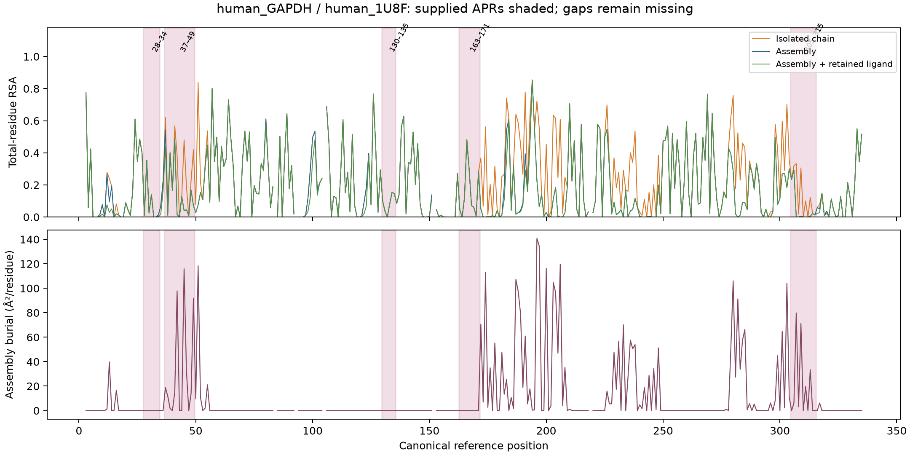
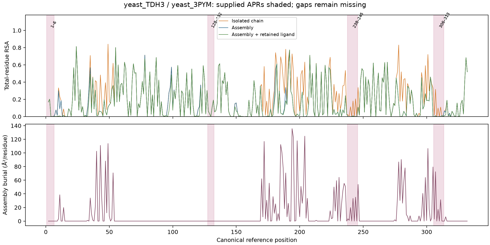
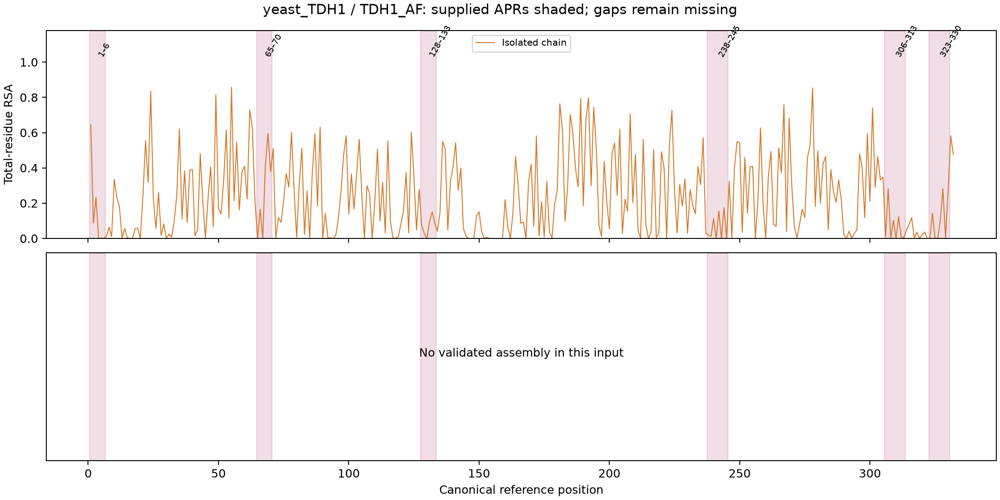
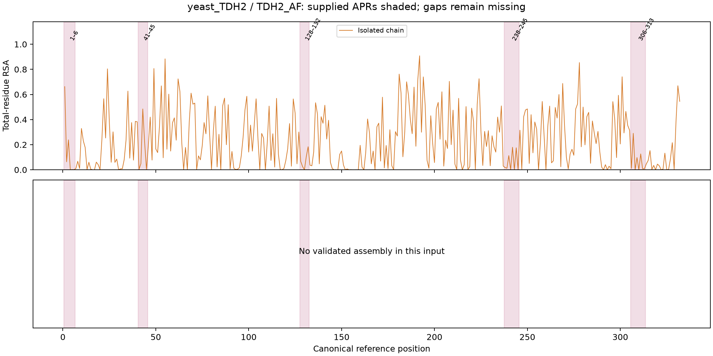

# GAPDH supplied consensus APRs

This report measures supplied predictions; it does not establish amyloid formation. Canonical sequence coordinates are 1-based and inclusive.

## Supplied APRs

| protein | start | end | sequence | confidence |
| --- | --- | --- | --- | --- |
| human_GAPDH | 28 | 34 | VDIVAIN | moderate |
| human_GAPDH | 37 | 49 | FIDLNYMVYMFQY | moderate |
| human_GAPDH | 130 | 135 | MFVMGV | moderate |
| human_GAPDH | 163 | 171 | VIHDNFGIV | moderate |
| human_GAPDH | 305 | 315 | DHFVKLISWYD | moderate |
| yeast_TDH1 | 1 | 6 | MIRIAI | moderate |
| yeast_TDH1 | 65 | 70 | IIIDGV | moderate |
| yeast_TDH1 | 128 | 133 | MFVVGV | moderate |
| yeast_TDH1 | 238 | 245 | VSVVDLTV | moderate |
| yeast_TDH1 | 306 | 313 | VKLISWYD | moderate |
| yeast_TDH1 | 323 | 330 | VDLIEYVA | strong |
| yeast_TDH2 | 1 | 6 | MVRVAI | moderate |
| yeast_TDH2 | 41 | 45 | SAYMF | moderate |
| yeast_TDH2 | 128 | 132 | MFVMG | moderate |
| yeast_TDH2 | 238 | 245 | VSVVDLTV | moderate |
| yeast_TDH2 | 306 | 313 | VKLVSWYD | moderate |
| yeast_TDH3 | 1 | 6 | MVRVAI | moderate |
| yeast_TDH3 | 128 | 132 | MFVMG | moderate |
| yeast_TDH3 | 238 | 245 | VSVVDLTV | moderate |
| yeast_TDH3 | 306 | 313 | VKLVSWYD | moderate |

## Native-context accessibility

One row represents one structure after averaging dependent chains at each position. Partial means use only positions eligible in every chain; they are not full-window estimates. Predicted monomers are reported separately from experimental assemblies.

| protein | apr_id | source | eligible_coverage | mean_RSA_native_observed | mean_delta_sasa_assembly | mean_delta_sasa_ligand | measurement_status |
| --- | --- | --- | --- | --- | --- | --- | --- |
| human_GAPDH | human_GAPDH_28_34 | experimental | 1 | 0.07757 | 0 | 0.2527 | complete |
| human_GAPDH | human_GAPDH_37_49 | experimental | 1 | 0.1603 | 30.74 | 2.04 | complete |
| human_GAPDH | human_GAPDH_130_135 | experimental | 1 | 0.08554 | 0 | 0 | complete |
| human_GAPDH | human_GAPDH_163_171 | experimental | 1 | 0.1514 | 0 | 0 | complete |
| human_GAPDH | human_GAPDH_305_315 | experimental | 1 | 0.05179 | 19.38 | 0 | complete |
| yeast_TDH3 | yeast_TDH3_1_6 | experimental | 0.8333 | 0.07459 | 0 | 0 | partial_or_missing |
| yeast_TDH3 | yeast_TDH3_128_132 | experimental | 1 | 0.07862 | 0 | 0 | complete |
| yeast_TDH3 | yeast_TDH3_238_245 | experimental | 1 | 0.001497 | 11.59 | 0 | complete |
| yeast_TDH3 | yeast_TDH3_306_313 | experimental | 1 | 0.003435 | 15.5 | 0 | complete |
| yeast_TDH1 | yeast_TDH1_1_6 | alphafold | 1 | 0.161 | NA | NA | complete |
| yeast_TDH1 | yeast_TDH1_65_70 | alphafold | 1 | 0.2602 | NA | NA | complete |
| yeast_TDH1 | yeast_TDH1_128_133 | alphafold | 1 | 0.07217 | NA | NA | complete |
| yeast_TDH1 | yeast_TDH1_238_245 | alphafold | 1 | 0.05956 | NA | NA | complete |
| yeast_TDH1 | yeast_TDH1_306_313 | alphafold | 1 | 0.06667 | NA | NA | complete |
| yeast_TDH1 | yeast_TDH1_323_330 | alphafold | 1 | 0.1007 | NA | NA | complete |
| yeast_TDH2 | yeast_TDH2_1_6 | alphafold | 1 | 0.1611 | NA | NA | complete |
| yeast_TDH2 | yeast_TDH2_41_45 | alphafold | 1 | 0.1514 | NA | NA | complete |
| yeast_TDH2 | yeast_TDH2_128_132 | alphafold | 1 | 0.07617 | NA | NA | complete |
| yeast_TDH2 | yeast_TDH2_238_245 | alphafold | 1 | 0.06246 | NA | NA | complete |
| yeast_TDH2 | yeast_TDH2_306_313 | alphafold | 1 | 0.06767 | NA | NA | complete |

## Primary burial tests

The configured primary metric is AA_standardized_RSA. All tests use a chain-averaged profile. Exact valid shifts retain each window length; windows cannot wrap across sequence termini. BH families separate experimental/predicted structures and global/window tests. A failed coverage requirement gives no p-value. Additional diagnostics are in null_tests.tsv.

| protein | apr_id | status | observed | n_unique_valid_masks | p_lower | q_BH |
| --- | --- | --- | --- | --- | --- | --- |
| human_GAPDH | ALL_CALLED | insufficient_coverage | NA | NA | NA | NA |
| human_GAPDH | human_GAPDH_28_34 | computed | -0.2197 | 265 | 0.3623 | 0.7619 |
| human_GAPDH | human_GAPDH_37_49 | computed | 0.2523 | 218 | 0.7477 | 0.7619 |
| human_GAPDH | human_GAPDH_130_135 | computed | 0.4015 | 273 | 0.7619 | 0.7619 |
| human_GAPDH | human_GAPDH_163_171 | computed | 0.09812 | 249 | 0.5341 | 0.7619 |
| human_GAPDH | human_GAPDH_305_315 | insufficient_coverage | NA | NA | NA | NA |
| yeast_TDH3 | ALL_CALLED | insufficient_coverage | NA | NA | NA | NA |
| yeast_TDH3 | yeast_TDH3_1_6 | insufficient_coverage | NA | NA | NA | NA |
| yeast_TDH3 | yeast_TDH3_128_132 | computed | 0.2433 | 303 | 0.6502 | 0.7619 |
| yeast_TDH3 | yeast_TDH3_238_245 | computed | -0.6858 | 288 | 0.04167 | 0.25 |
| yeast_TDH3 | yeast_TDH3_306_313 | insufficient_coverage | NA | NA | NA | NA |
| yeast_TDH1 | ALL_CALLED | insufficient_coverage | NA | NA | NA | NA |
| yeast_TDH1 | yeast_TDH1_1_6 | computed | -0.03785 | 299 | 0.4515 | 0.5079 |
| yeast_TDH1 | yeast_TDH1_65_70 | computed | 0.5041 | 299 | 0.8595 | 0.8595 |
| yeast_TDH1 | yeast_TDH1_128_133 | computed | -0.4556 | 299 | 0.1839 | 0.3311 |
| yeast_TDH1 | yeast_TDH1_238_245 | computed | -0.5736 | 289 | 0.07958 | 0.3311 |
| yeast_TDH1 | yeast_TDH1_306_313 | insufficient_coverage | NA | NA | NA | NA |
| yeast_TDH1 | yeast_TDH1_323_330 | computed | -0.4371 | 289 | 0.173 | 0.3311 |
| yeast_TDH2 | ALL_CALLED | insufficient_coverage | NA | NA | NA | NA |
| yeast_TDH2 | yeast_TDH2_1_6 | computed | -0.06787 | 299 | 0.4381 | 0.5079 |
| yeast_TDH2 | yeast_TDH2_41_45 | computed | -0.1252 | 304 | 0.4112 | 0.5079 |
| yeast_TDH2 | yeast_TDH2_128_132 | computed | -0.5514 | 304 | 0.1612 | 0.3311 |
| yeast_TDH2 | yeast_TDH2_238_245 | computed | -0.5239 | 289 | 0.1176 | 0.3311 |
| yeast_TDH2 | yeast_TDH2_306_313 | insufficient_coverage | NA | NA | NA | NA |

## Coverage and interpretation

| protein | apr_id | missing_or_ineligible_positions | eligible_coverage |
| --- | --- | --- | --- |
| yeast_TDH3 | yeast_TDH3_1_6 | 1 | 0.8333 |

AA-standardized tests can also lack values for rare amino-acid types even where coordinates exist. The configured minimum count and zero-variance rule are not relaxed after seeing APRs. See missing_positions in null_tests.tsv.

- SASA and ligand occlusion are frozen-coordinate measurements, not relaxed apo/monomer simulations.
- Four chains in a tetramer are dependent observations. Homologues and yeast paralogues are not independent biological replicates.
- A backbone H-bond proxy and a DSSP edge candidate do not prove exposed amyloid-forming beta edges.
- Missing annotations, missing atoms and unavailable oligomer states remain missing; projected homologous windows are not new APR predictions.
- Composition sampling preserves residue counts but not contiguous blocks. It is a sensitivity analysis, not an equivalent null for sequence windows.

- Human TANGO predictions were absent from the source predictor panel; yeast TDH1/TDH2/TDH3 had TANGO. Check availability and a common-predictor sensitivity analysis before comparing species.
- The TDH1/TDH2 inputs are AlphaFold monomers. No experimental tetramer protection is inferred for those proteins.

## human_GAPDH: human_1U8F

## yeast_TDH3: yeast_3PYM

## yeast_TDH1: TDH1_AF

## yeast_TDH2: TDH2_AF

## Output guide

- validated_aprs.tsv: imported calls, original class/tools, peptide and source hashes.
- apr_summary.tsv / chain_metrics.tsv: structure-level measurements and dependent-chain diagnostics.
- null_tests.tsv / nulls/: test statuses, effect sizes, p/q values and actual null draws.
- apr_contact_pairs.tsv / apr_backbone_hbonds.tsv / apr_ligand_contacts.tsv: observed interaction records involving APRs.
- strand_overlap.tsv: APR intersections with DSSP strands and edge candidates, separated by context.
- homologous_groups.tsv / homologous_group_metrics.tsv: exact MSA projections with called_here and native_called_fraction.
- pymol/: per-structure JSON, PML, command examples, sessions and images after rendering.
- run_manifest.json: source hashes, software versions, settings and completion status.
